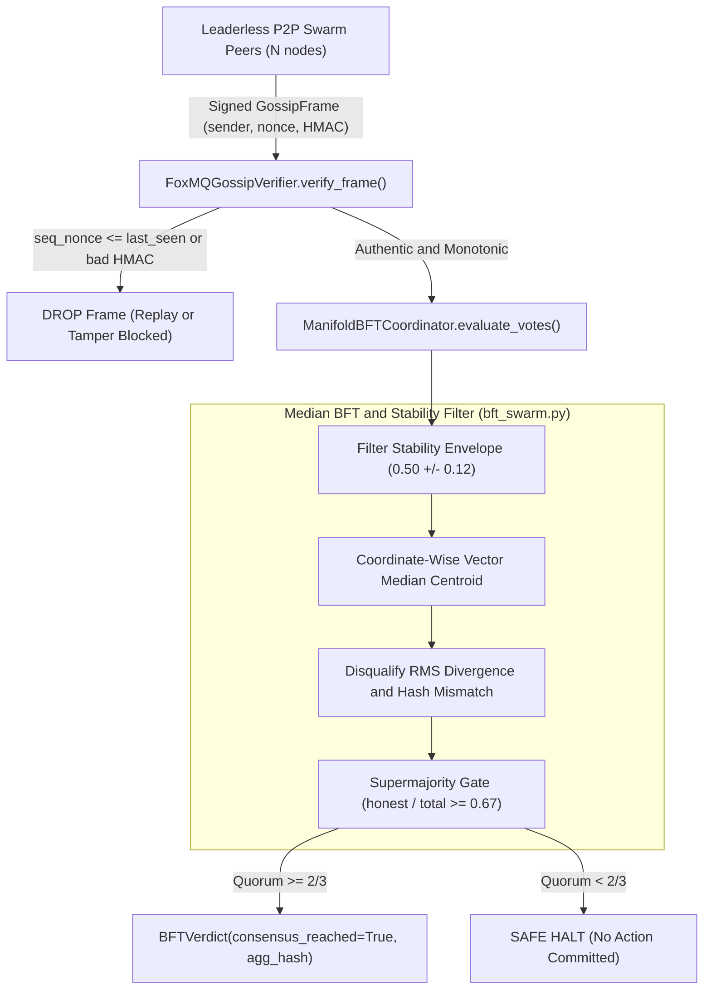
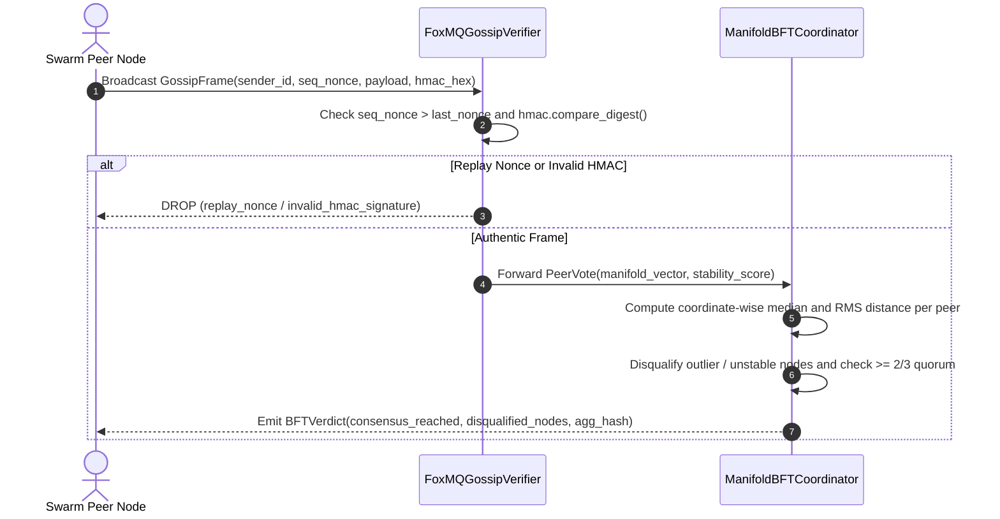

# DoraHacks BUIDL Submission: Vertex Swarm Agent

**Track**: Leaderless P2P Agent Swarms  
**GitHub Repo**: `https://github.com/manderson240/vertex-swarm-agent`  
**Demo Video**: [`docs/vertex_swarm_demo.mp4`](docs/vertex_swarm_demo.mp4)  
**Contact Info**: Telegram `@manderson240`, Discord `miked238725`  

---

## Form Fields for DoraHacks

### 1. Project Name
```text
Vertex Swarm Agent
```

### 2. Brief Description (Under 120 characters)
```text
Leaderless coordinate-wise median BFT consensus and HMAC/monotonic P2P FoxMQ firewall for multi-agent swarms.
```

### 3. Tags
`Swarms`, `P2P`, `Byzantine Fault Tolerance`, `DePIN`, `Edge AI`, `Zero-Cloud`, `FoxMQ`, `Consensus`

---

## Project Description

### Why I built this
Autonomous robot, drone, and edge-AI swarms operating without reliable cloud connectivity fail under two common failure modes:
1. **Single-point-of-failure coordinators**: Centralized orchestration halts the swarm when backhaul partitions occur.
2. **Arithmetic mean poisoning and replay spoofing**: Plain averaging over peer vectors lets a single malicious peer submitting an extreme vector corrupt global consensus, and unauthenticated P2P packets are trivial to replay or spoof.

### How it works
Implemented in `src/vertex_swarm_spoke/bft_swarm.py` using only the Python standard library:
1. **Coordinate-wise median BFT (`ManifoldBFTCoordinator`)**: Filters votes whose stability score is within `0.50 +/- 0.12` (configured via `hiho_target=0.50, hiho_tolerance=0.12`), computes the coordinate-wise median vector centroid, disqualifies peers with wrong action hashes, stability drift, or RMS divergence `> 0.35`, and requires an honest supermajority (`>= 0.67`) before committing a 16-hex SHA-256 `aggregate_manifold_hash`. Because coordinate-wise medians have a breakdown point just under 50% (combined here with a 2/3 honest quorum requirement), up to one-third faulty peers cannot pull the centroid arbitrarily far.
2. **Leaderless gossip verifier (`FoxMQGossipVerifier`)**: Authenticates P2P frames with constant-time `hmac.compare_digest` HMAC-SHA256 verification and strict per-sender monotonic sequence numbers, dropping replayed nonces and tampered frames in microseconds.

---

## Architecture and Flow





---

## Verification and Benchmark

- **Unit tests (`tests/test_vertex_swarm_spoke.py`)**: `3/3` passing in `0.01s`, covering honest 5/5 supermajority agreement, disqualification of an extreme vector outlier and an out-of-envelope stability score (`4/6` rejected, `5/6` accepted), and replay/HMAC tampering rejection on `FoxMQGossipVerifier`.
- **Latency benchmark (`scripts/bench.py`)**: Over 20,000 iterations on my machine using Python stdlib only:
  - `ManifoldBFTCoordinator.evaluate_votes` (6 peers, 16D vectors): `0.0137 ms` p50, `0.0232 ms` p99
  - `FoxMQGossipVerifier.verify_frame`: `0.0010 ms` p50, `0.0016 ms` p99

```bash
git clone https://github.com/manderson240/vertex-swarm-agent.git
cd vertex-swarm-agent
uv sync
uv run pytest tests/test_vertex_swarm_spoke.py -v
PYTHONPATH=src uv run python scripts/bench.py
```

---

## Walkthrough Video Chapters (`docs/vertex_swarm_demo.mp4`, 2560x1440)

1. Scene 0: Title card, leaderless BFT consensus, and FoxMQ firewall overview
2. Scene 1: Single coordinator vs median BFT comparison
3. Scene 2: Source walkthrough: `ManifoldBFTCoordinator` (`src/vertex_swarm_spoke/bft_swarm.py`)
4. Scene 3: Source walkthrough: `FoxMQGossipVerifier` HMAC and nonce check
5. Scene 4: Terminal demo: 2/3 quorum certified, outlier and replay blocked
6. Scene 5: Full 3/3 pytest run and quickstart commands
